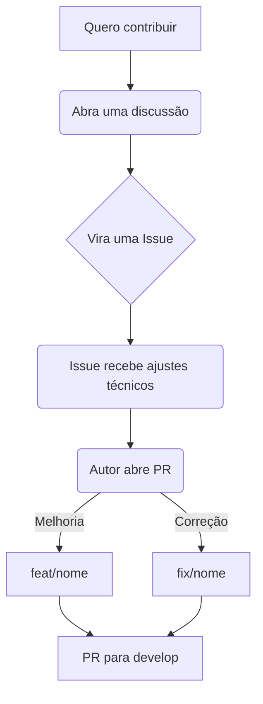

<!-- AGENT-INDEX
purpose: High-level overview of the codaqui/institucional monorepo.
audience: New contributors, casual readers, AI agents
sections:
  - Sobre o Repositório (monorepo: app Astro em frontend/ + backend NestJS)
  - Quickstart (site, API local, full stack)
  - Estrutura de Diretórios
  - Espaços de Discussão (Discord, WhatsApp, GitHub)
  - Deploy (resumo — Cloudflare Pages + backend ARM64)
  - Licença e Contato
  - Fluxo de Contribuição (mermaid)
related-docs:
  - AGENTS.md — main guide for AI agents (rules, patterns, anti-patterns)
  - DEVELOPMENT.md — setup, env, deploy
  - backend/README.md — backend-specific
agent-protocol: README is intentionally short. For implementation details, go to AGENTS.md or DEVELOPMENT.md.
-->

# CODAQUI


[](https://sonarcloud.io/summary/new_code?id=codaqui_institucional)

Codaqui é uma **associação brasileira sem fins lucrativos** que democratiza educação em tecnologia para jovens, servindo como guarda-chuva para comunidades parceiras de tech.

**Site**: https://codaqui.dev · **CNPJ**: 44.593.429/0001-05

---

## Sobre o Repositório

Este repositório é um **monorepo** com duas camadas:

| Camada | Diretório | Stack | Hospedagem |
|--------|-----------|-------|------------|
| **Site** — portal codaqui.dev, blog, trilhas e sites whitelabel das comunidades | [`frontend/`](./frontend) | Astro 7 · React 19 · Tailwind/MUI | Cloudflare Pages — automático via CI |
| **API** — eventos, ledger, Stripe, membros, e-mails | [`backend/`](./backend/README.md) | NestJS 11 · TypeORM · PostgreSQL 18 | Servidor ARM64 (Podman Compose) |

Na raiz ficam também os **scripts de sincronização** (`scripts/`), que buscam dados externos (Discord, Meetup, analytics) e gravam snapshots versionados em `static/`, consumidos pelo build do site. O `backend/` **nunca** é publicado junto com o site.

---

## Quickstart

Requer **Node ≥ 24**. Para a API e infra local, **Podman** (ou Docker com o binário `podman` disponível).

Primeira vez:

```bash
make setup   # cria o .env a partir do .env.example e instala as dependências (raiz, frontend/, backend/)
```

Depois, conforme o que vai mexer:

| Quero... | Comando | URL |
|----------|---------|-----|
| Só o site (Astro) | `make astro-dev` | http://localhost:4321 |
| Só a API (NestJS) | `make db-up` (PostgreSQL) e `make backend-start` | http://localhost:3000 |
| API via containers + webhooks Stripe | `make up` | API em http://localhost:3001 · banco em localhost:5432 |

> Sem Podman: o site roda standalone com `cd frontend && npm install && npm run dev` — as páginas que consomem a API mostram fallback quando ela está offline.

Setup completo, variáveis de ambiente e deploy: **[DEVELOPMENT.md](./DEVELOPMENT.md)**. Padrões de código e anti-patterns: **[AGENTS.md](./AGENTS.md)**.

---

## Estrutura de Diretórios

```
institucional/
├── frontend/          # 🚀 App Astro — portal codaqui.dev + builds whitelabel (tenants)
├── backend/           # 🖥️ API NestJS (eventos, ledger, Stripe, membros, notificações)
├── blog/              # ✍️ Fonte canônica dos posts (copiada para o Astro em build-time)
├── trilhas/           # 📚 Fonte canônica das trilhas (Python, GitHub)
├── comunidades/       # 🗃️ Conteúdo whitelabel legado (era do Docusaurus) — fora do build Astro
├── static/            # 📦 Assets + snapshots gerados pelos syncs (events/, social-stats/, analytics/)
├── scripts/           # 🔄 Syncs e validações (rodam local e nos workflows)
├── docs/              # 📑 Documentação técnica (ADRs, módulos, planos)
└── .github/workflows/ # CI — deploy Pages, PR check, syncs, publish da imagem do backend
```

---

## Espaços de Discussão

- Discussões e docs: [codaqui.dev](https://codaqui.dev) · [GitHub Discussions](https://github.com/codaqui/institucional/discussions)
- Participantes: [Discord](https://discord.gg/xuTtxqCPpz) · [Manual do Participante](https://www.codaqui.dev/participe/estudar)
- Voluntários: [Manual do Voluntário](https://www.codaqui.dev/participe/apoiar)
- WhatsApp: [Acesse aqui](https://chat.whatsapp.com/IvzONDeglw55ySBD71F4Up)

---

## Deploy

- **Sites (codaqui.dev + tenants das comunidades):** push em `main` dispara [`.github/workflows/deploy-astro.yml`](./.github/workflows/deploy-astro.yml) — build matrix (codaqui + T.I. Social + Elas no Código + DevParaná) com *direct upload* no Cloudflare Pages. Outras branches viram previews em `<branch>.<projeto>.pages.dev`.
- **Backend:** imagem multi-arch publicada manualmente via workflow `publish-backend.yml` e subida no servidor com `compose.prod.yaml`.

Detalhes, secrets e runbook: [DEVELOPMENT.md](./DEVELOPMENT.md#deploy).

---

## Licença e Contato

- **Licença:** Creative Commons Attribution-ShareAlike
- **Contato:** contato@codaqui.dev
- **Repositório:** https://github.com/codaqui/institucional

---

## Fluxo de Contribuição


