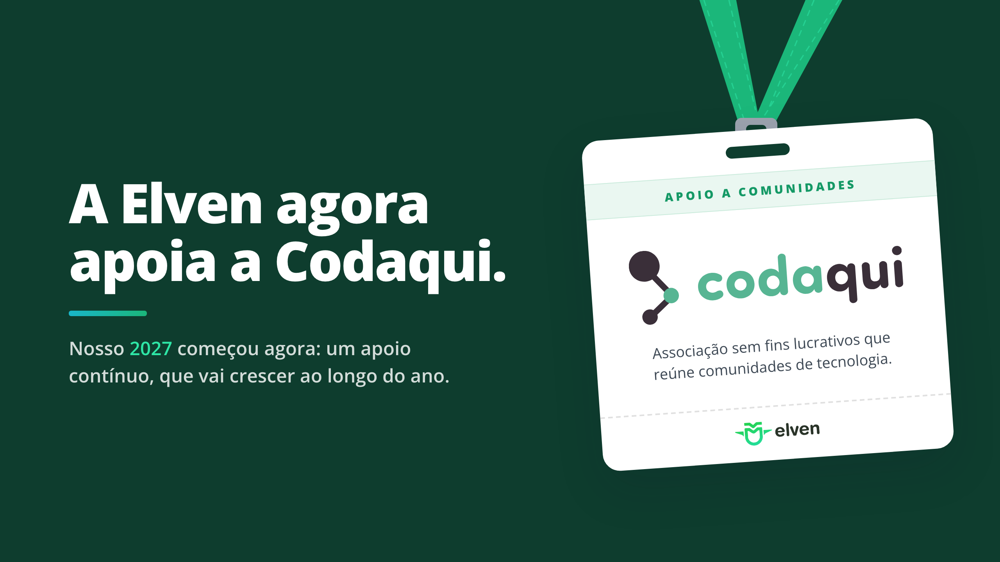

A Elven passou a apoiar a Codaqui. Somos uma empresa brasileira de observabilidade e gestão de incidentes, e chegamos aqui como parceiros: para estar perto das comunidades, construir vínculos, abrir portas e ajudar a formar novos profissionais de tecnologia.

Neste post, contamos quem somos, por que decidimos começar agora e o que queremos construir juntos.

<!-- truncate -->

## Quem somos

A Elven nasceu em 2020 para ajudar empresas a manter seus produtos digitais de pé, com monitoramento, observabilidade e gestão de incidentes.

Formar gente faz parte da nossa história desde cedo. Em 2021, criamos o Programa de Formação em SRE, porque o mercado procurava pessoas capacitadas em Cloud, DevOps e SRE e faltava quem formasse. Mantemos aberto no nosso site o livro de SRE do Google em português e o Workbook de SRE, para quem quiser estudar. Em 2026, realizamos a primeira edição do Observability Day e uma série de encontros presenciais, como o meetup Por Trás do Clique, em outubro, em Maringá.

O que você encontra em elven.works

No site oficial, você conhece os produtos e serviços da Elven, confere cases de sucesso e pode testar a plataforma gratuitamente.

## Por que agora

2027 vai ser um ano com um objetivo claro para nós: apoiar ainda mais as comunidades de tecnologia. Fazia sentido começar antes, ao lado de quem já faz esse trabalho o ano inteiro.

E a Codaqui faz esse trabalho por várias comunidades ao mesmo tempo, como DevParaná, Elas no Código, CamposTech, TI Social, Cloud Native Maringá e Cumbuca Dev. Estar ao lado da Codaqui é estar perto de todas elas, e de muita gente que está construindo a carreira em tecnologia.

O apoio é contínuo, sem data para acabar. E a ideia é que ele cresça ao longo de 2027.

## O que é ser parceiro, para nós

Ser parceiro é estar presente. É ir aos encontros, conhecer as pessoas pelo nome, voltar no mês seguinte e no outro. Vínculo se constrói assim, com tempo.

Também queremos ajudar a abrir portas. Comunidade é onde muita gente faz a primeira palestra, encontra a primeira mentoria e conversa pela primeira vez com quem já trabalha na área que quer seguir. Se a gente puder encurtar esse caminho para alguém, já valeu.

E queremos ajudar a formar novos profissionais. Fazemos isso desde 2021 com o Programa de Formação em SRE, e as comunidades fazem isso todos os dias, perto de quem está começando. Somar as duas coisas faz sentido.

## O que queremos construir juntos

Entre as ideias que queremos tirar do papel com a Codaqui e as comunidades:

- pessoas do nosso time palestrando e participando dos encontros das comunidades;
- mentoria em observabilidade, SRE e carreira em infraestrutura;
- conteúdo técnico em português, aberto para quem está começando;
- espaço e estrutura para encontros, quando fizer sentido.

## Um convite

Se você está chegando na área: participe. Vá ao próximo encontro, faça a pergunta que parece óbvia, entre numa trilha, peça mentoria. E, quando puder, devolva. É assim que a roda gira.

A gente vai estar por lá. Nos vemos nos próximos encontros.

<section class="my-8 rounded-2xl border border-border bg-sunken p-6" aria-labelledby="proximos-passos-elven">
<h2 id="proximos-passos-elven" class="mt-0 text-2xl font-extrabold text-text-primary">Faça parte dessa rede</h2>

Conheça o trabalho da Elven ou traga sua empresa para apoiar financeiramente a Codaqui e as comunidades.

<a href="https://elven.works/" target="_blank" rel="noopener noreferrer" class="inline-flex min-h-11 items-center justify-center rounded-lg border border-link px-5 py-3 font-bold text-link! no-underline! transition-colors hover:bg-action hover:text-on-action!">Visitar elven.works</a>
<a href="/participe/apoiar?modo=empresa" class="inline-flex min-h-11 items-center justify-center rounded-lg bg-action px-5 py-3 font-bold text-on-action! no-underline! transition-colors hover:bg-action-hover">Quero apoiar com minha empresa</a>

</section>
